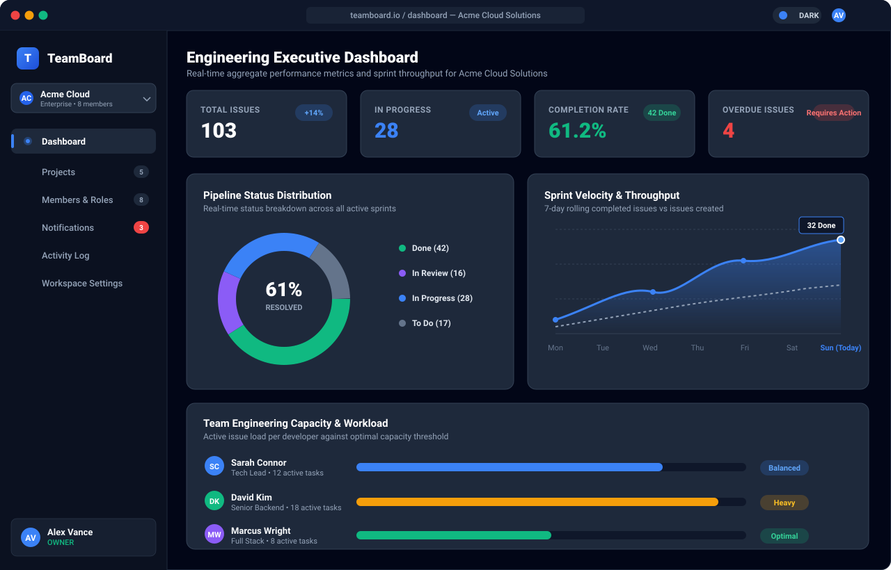
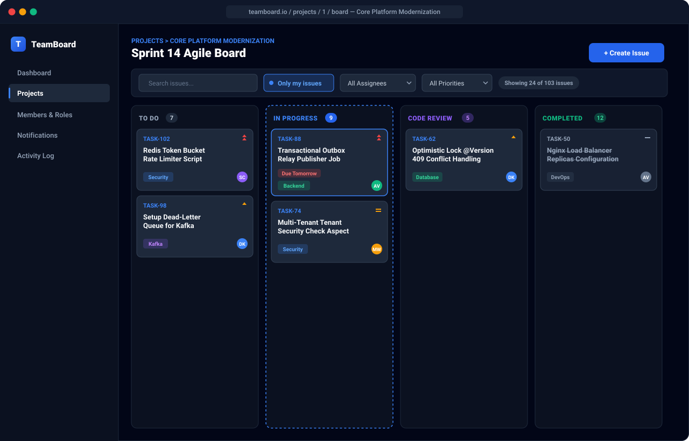
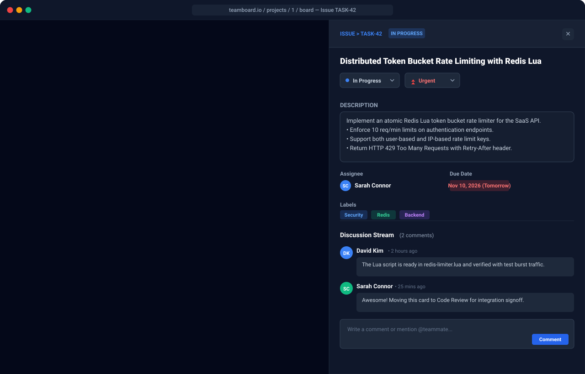
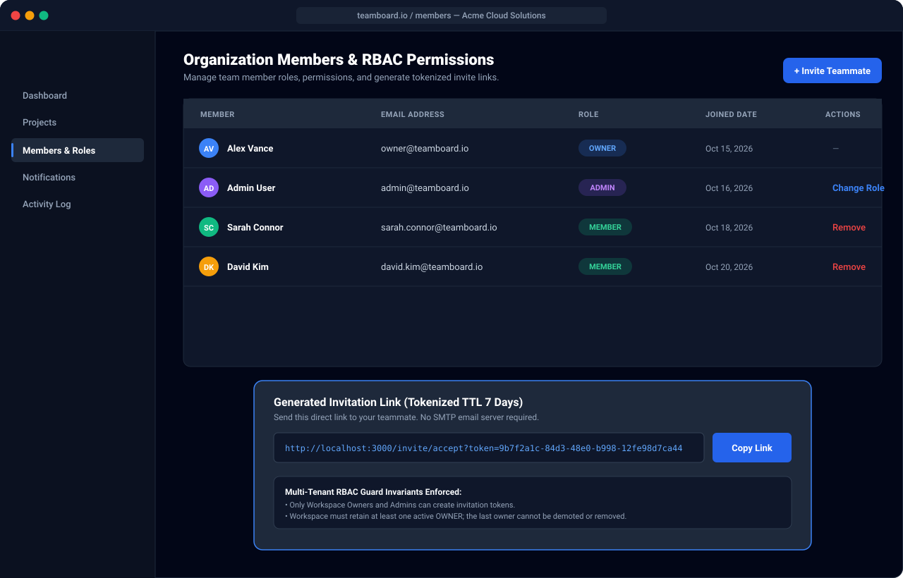
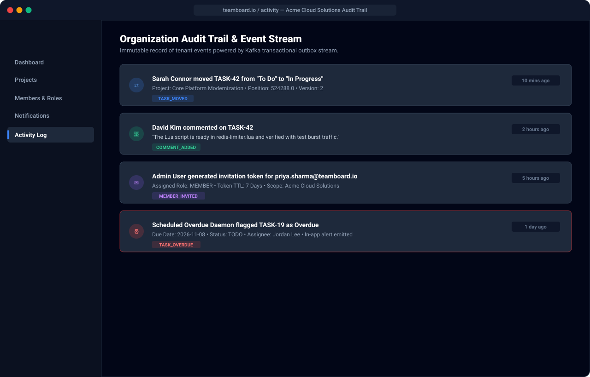
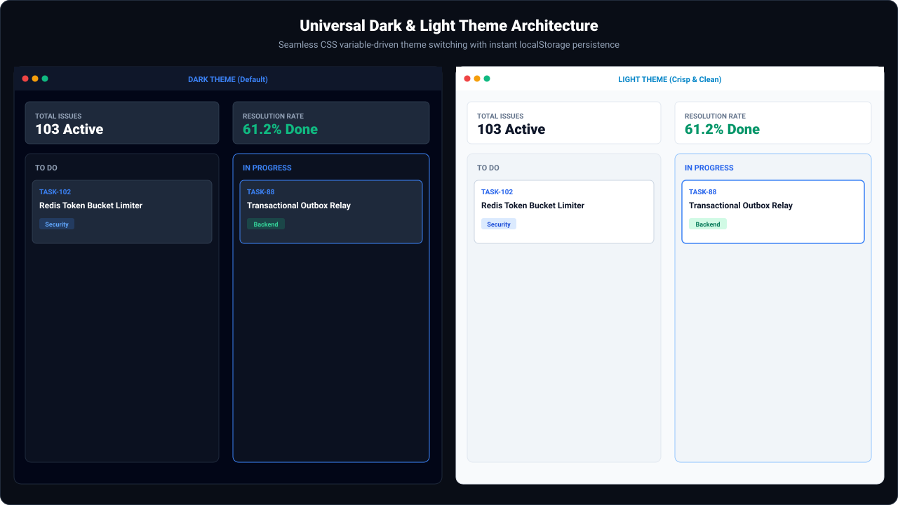

# TeamBoard 🚀

[](https://github.com/VirendraArekar/multi-tenant-project-task-management/actions/workflows/ci.yml)
[](https://adoptium.net/)
[](https://spring.io/projects/spring-boot)
[](https://nextjs.org/)
[-red.svg)](https://kafka.apache.org/)
[](https://www.mysql.com/)
[](https://redis.io/)

**TeamBoard** is a production-style, highly scalable multi-tenant project and task management SaaS platform. Built as a flagship portfolio system demonstrating modern enterprise architecture, it delivers end-to-end multi-tenant isolation, stateless horizontal scalability across load-balanced backend replicas, transactional outbox event streaming via Apache Kafka, distributed token bucket rate limiting via Redis, optimistic concurrency control on Kanban boards, and a modern Next.js 15 App Router frontend.

> **Zero Dummy Data**: The app starts with a clean database. Every user, workspace, project, task, card drag, comment, invite, notification, and audit event is created through live user actions.

---

## ⚡ Quick Start (One Command)

### Prerequisites
- Docker Engine 24+ and Docker Compose v2+
- Git

### 1. Automated Setup & Start
Run the setup script (generates cryptographically secure secrets in `.env` and boots all services):

**Linux / macOS:**
```bash
chmod +x setup.sh
./setup.sh
```

**Windows (PowerShell):**
```powershell
.\setup.ps1
```

Or manually:
```bash
cp .env.example .env
docker compose up --build
```

### 2. Access the Application
- **Web Frontend**: [http://localhost:80](http://localhost:80) (or [http://localhost:3000](http://localhost:3000))
- **Swagger / OpenAPI**: [http://localhost:80/swagger-ui.html](http://localhost:80/swagger-ui.html)
- **Actuator Health & Metrics**: [http://localhost:80/actuator/health](http://localhost:80/actuator/health)
- **Prometheus Dashboard**: [http://localhost:9090](http://localhost:9090)
- **Grafana Metrics**: [http://localhost:3001](http://localhost:3001) (`admin` / password from `.env`)

### 3. Pre-Seeded Demo Accounts (100+ Live Tasks & Projects)
The database automatically seeds 100+ realistic engineering tasks across Kanban columns, multiple projects, activity logs, and pre-configured role-based user accounts:

| Role | Email | Password | Organization / Tenant |
| :--- | :--- | :--- | :--- |
| **Owner** | `owner@teamboard.io` | `Password123!` | Acme Cloud Solutions |
| **Admin** | `admin@teamboard.io` | `Password123!` | Acme Cloud Solutions |
| **Member** | `user@teamboard.io` | `Password123!` | Acme Cloud Solutions |
| **Teammate** | `sarah.connor@teamboard.io` | `Password123!` | Acme Cloud Solutions |
| **Teammate** | `david.kim@teamboard.io` | `Password123!` | Acme Cloud Solutions |

*You can also click **Get Started** on the landing page to register brand-new organizations and users dynamically.*

---

## 📸 Application Screenshots

### 1. Engineering Executive Dashboard & Dynamic Analytics
Real-time KPI metrics, pure SVG interactive pipeline donut gauge with completion percentage, 7-day sprint velocity wave chart with gradient fills, and team engineering workload capacity bars.



---

### 2. Jira-Style Agile Kanban Board
Interactive drag-and-drop workflow with column highlight rings, Jira issue keys (`TASK-X`), directional priority icons, and quick-filter toolbar (Search, "Only my issues" toggle, Assignee dropdown, Priority dropdown, and active count badges).



---

### 3. Issue Inspection Drawer & Discussion Stream
Slide-out Jira-style task inspection panel featuring status selector, priority controls, rich description editor, assignee avatar, label chips, and real-time activity discussion comments.



---

### 4. Organization Members, Roles & Tokenized Invitations
Multi-tenant RBAC table with `OWNER`, `ADMIN`, and `MEMBER` role management, invariant protection guards (last owner cannot be removed), and tokenized 7-day invitation link generator with one-click copy.



---

### 5. Organization Audit Trail & Event Stream
Immutable activity log stream capturing tenant events dispatched through the transactional outbox pattern and Apache Kafka consumers (`TASK_MOVED`, `COMMENT_ADDED`, `MEMBER_INVITED`, `TASK_OVERDUE`).



---

### 6. Universal Dark & Light Mode Theme Architecture
Side-by-side comparison of the deep Slate-950 Dark Theme and crisp Slate-50 Light Theme with instant local storage persistence and system preference matching.



---

## 🛠 Tech Stack

| Tier | Technologies |
| :--- | :--- |
| **Backend** | Java 25, Spring Boot 4.0.9, Spring Security (Stateless JWT), Spring Data JPA, Hibernate ORM 7, Maven |
| **Database** | MySQL 8.0 with Flyway automated schema migrations & composite multi-tenant indexes |
| **Cache & Limiting**| Redis 7 (Atomic Lua Token Bucket Rate Limiting, Dashboard Caching, Refresh Token Store) |
| **Event Streaming** | Apache Kafka 3.8.0 (KRaft mode, no Zookeeper), Transactional Outbox Pattern, Idempotent Consumers, Dead-Letter Queue (DLQ) |
| **Load Balancer** | Nginx (Round-robin across 2+ stateless Spring Boot replicas, SSL termination, gzip) |
| **Frontend** | Next.js 15 (App Router, Standalone Output), React 19, TypeScript, Tailwind CSS, Lucide Icons |
| **Observability** | Micrometer, Prometheus actuator metrics exporter, Grafana |
| **Testing** | JUnit 5, Mockito, Testcontainers (MySQL, Redis, Kafka), Playwright E2E, k6 Load Testing |

---

## ✨ Core Features

1. **Authentication & Multi-Tenancy**:
   - Register automatically provisions a new user and their first organization workspace.
   - Dual-token auth: 15-minute stateless JWT access tokens and 7-day secure refresh tokens.
   - Central `TenantSecurityService` validates user workspace membership and RBAC role on every single request.
2. **Organizations & Role-Based Access Control**:
   - Roles: `OWNER`, `ADMIN`, `MEMBER`.
   - Business invariants: Cannot remove or demote the last owner; admins cannot demote or remove owners.
   - Create, switch between, and rename organizations.
3. **Invitations**:
   - Tokenized invite links with 7-day TTL (no external mail dependency: links display in UI with one-click copy).
   - Public invite validation endpoint (`GET /api/v1/invites/{token}`) and authenticated acceptance flow (`POST /api/v1/invites/{token}/accept`).
4. **Jira-Style Agile Kanban Board & Ergonomics**:
   - Interactive drag-and-drop between columns (`TODO`, `IN_PROGRESS`, `IN_REVIEW`, `DONE`) with active column highlight rings and card elevation.
   - **Jira Issue Keys & Quick-Filters**: Instant search by title/description, 1-click **"Only my issues"** toggle, Assignee and Priority dropdown filters, and active issue counters (`Showing X of Y issues`).
   - Fractional positioning math (`position = (prev + next) / 2.0`) prevents bulk re-indexing.
   - **Optimistic Concurrency Control (`@Version`)**: Detects card move collisions with instant HTTP 409 responses, triggering frontend optimistic rollback and sync.
5. **Dark & Light Mode Theme Support**:
   - Universal theme switcher (Sun / Moon) accessible from the header and sidebar.
   - Smooth CSS transitions with `localStorage` persistence and system color preference matching across all 13 pages, drawers, modals, tables, and auth forms.
6. **Dynamic Dashboard Analytics & SVG Charts**:
   - **Pipeline Donut Gauge**: Pure SVG radial chart tracking completion across columns with center resolution percentage.
   - **Sprint Velocity Wave Chart**: Smooth SVG area chart with gradient fills and interactive hover data points tracking daily throughput.
   - **Team Workload Capacity**: Real-time progress meters displaying task distribution and workload statuses (*Balanced*, *Heavy*) per engineer.
7. **Transactional Outbox & Kafka Streams**:
   - Domain events (`task-events`, `comment-events`, `membership-events`, `overdue-events`) are written atomically to `outbox_events` table within the business JPA transaction.
   - `OutboxRelayScheduler` polls pending records and routes messages to Kafka with partition key = `organization_id`.
   - `EventConsumerService` uses `processed_events` table to enforce **idempotent deduplication**, routing failed poison messages to `teamboard-dead-letter`.
8. **Task Details & Collaboration**:
   - Jira-style slide-out task drawer with live description editing, priority badges, due dates, assignee assignment, label management, and real-time comment stream.
9. **Overdue Task Tracking**:
   - Automated `@Scheduled` cron worker identifies non-DONE tasks past due date and fires `TASK_OVERDUE` events.
10. **Real-Time Notifications & Audit Trail**:
   - Activity log capturing immutable organization history (who did what, entity affected, timestamp).
   - In-app notification bell with unread badge counter and polling synchronization.
11. **Distributed Rate Limiting**:
   - Token bucket algorithm implemented via atomic Redis Lua script.
   - Per-IP and per-user buckets with strict 10 req/min thresholds on auth endpoints, returning 429 with standard `Retry-After` headers.

---

## 🏛 System Architecture & Design

For in-depth architectural diagrams, request lifecycles, database ER diagrams, and horizontal scaling strategies, see:
- 📖 [Architecture & System Design](docs/architecture.md)
- ⚖️ [Architectural Decision Records (ADRs)](docs/decisions.md)
- 🔌 [REST API Documentation](docs/api.md)

---

## 🧪 Testing Suite

### 1. Unit & Service Tests
```bash
cd backend
mvn test
```
Runs 22 unit tests covering role enforcement, invite expirations, overdue scanning, position mathematics, and token bucket calculations.

### 2. Testcontainers Integration Tests
```bash
cd backend
mvn test -Dtest=TeamBoardIntegrationTest
```
Spins up real isolated Docker containers for **MySQL 8.0**, **Redis 7**, and **Apache Kafka 3.8.0**:
- Tests end-to-end user registration -> project creation -> task creation -> task move.
- Verifies strict multi-tenant isolation (User B is blocked from reading Org A data with 403 Forbidden).
- Verifies optimistic lock collisions return 409 Conflict.
- Verifies rate limiter returns 429 Too Many Requests under burst traffic.
- Verifies transactional outbox -> Kafka publication -> consumer deduplication.

### 3. Frontend Playwright E2E Test
```bash
cd frontend
npm run test:e2e
```
Automates the full browser journey: registration, workspace onboarding, project creation, task management, card drag-and-drop, comments, and invites.

### 4. k6 Concurrency & Load Testing
```bash
k6 run k6/load-test.js
```
Simulates 100 concurrent virtual users exercising read-heavy Kanban queries (cached in Redis) and write-heavy task movements under strict latency thresholds ($p95 < 250\text{ms}$).

---

## 📦 Docker Topology

```
├── nginx (Port 80)                # Gateway & Round-Robin Load Balancer
│   ├── backend-1 (Port 8080)      # Spring Boot Replica 1 (Java 25)
│   ├── backend-2 (Port 8080)      # Spring Boot Replica 2 (Java 25)
│   └── frontend (Port 3000)       # Next.js 15 Standalone
├── mysql (Port 3306)              # MySQL 8.0 Relational Storage
├── redis (Port 6379)              # Redis 7 In-Memory Cache & Limiter
├── kafka (Port 9092)              # Apache Kafka 3.8.0 (KRaft Mode)
├── prometheus (Port 9090)         # Prometheus Actuator Metrics Scraper
└── grafana (Port 3001)            # Performance & Health Dashboards
```

---

## 🔒 Security & Quality Standards
- No hard-coded secrets: All credentials generated dynamically by `setup.sh` into `.env`.
- Non-root execution: Docker containers run as unprivileged `teamboard` (UID 1001) and `nextjs` (UID 1001).
- Correlation IDs: Injected via `TraceIdFilter` (`X-Trace-ID`) and logged in structured format across all logs.
- Bean Validation: Standardized `@Valid` constraints on all inbound request bodies.
