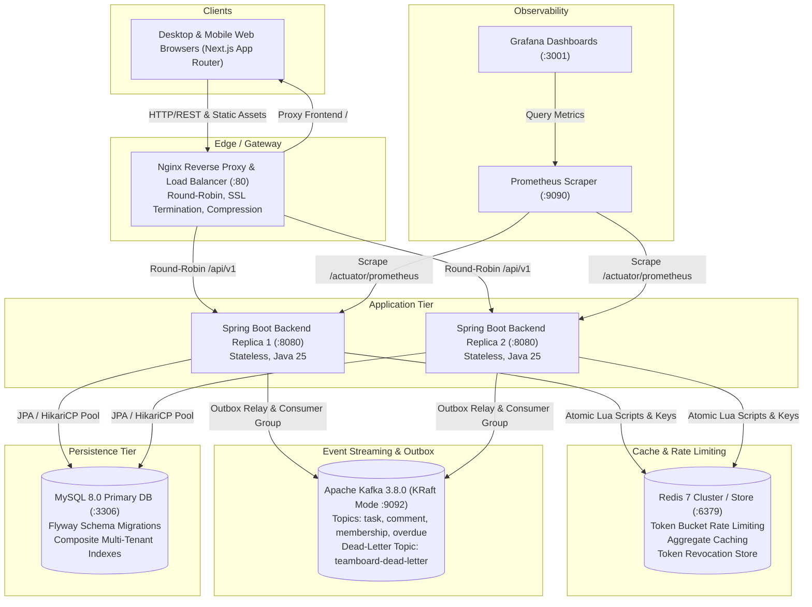
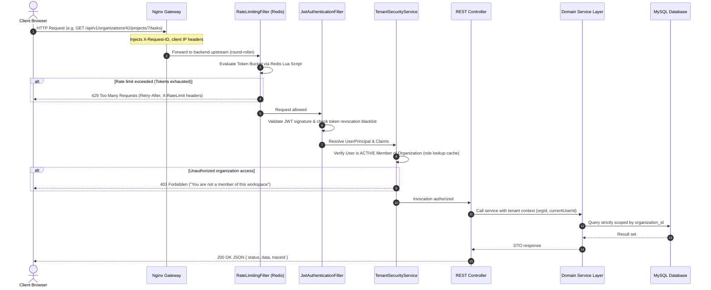
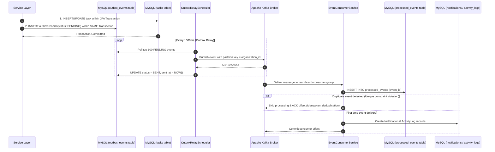
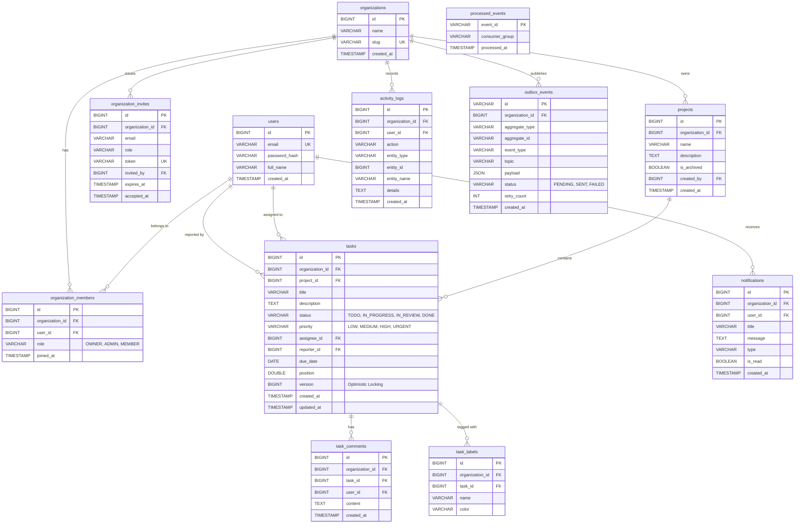

# TeamBoard Architecture & System Design Document

This document details the architectural topology, distributed patterns, data models, and scaling strategy of **TeamBoard** — a production-grade, multi-tenant SaaS project and task management platform.

---

## 1. High-Level System Architecture

TeamBoard is designed with a **stateless, horizontally scalable application layer** deployed behind an Nginx load balancing reverse proxy, backed by a persistent relational database (MySQL 8), an in-memory token bucket rate limiter and aggregate cache (Redis 7), and an event streaming backbone (Apache Kafka in KRaft mode).



---

## 2. Request Flow Lifecycle

Every inbound HTTP request progresses through a standardized multi-tenant pipeline:



---

## 3. Asynchronous Event Pipeline (Transactional Outbox Pattern)

To guarantee **zero lost messages** and prevent dual-write anomalies (e.g., database commit succeeds but Kafka producer fails or network partitions occur), TeamBoard strictly enforces the **Transactional Outbox Pattern**:



### Dead-Letter Queue (DLQ) Strategy
If a poison message fails deserialization or throws unexpected runtime exceptions after 3 retry attempts with exponential backoff (1s, 2s, 4s), it is automatically rerouted to the `teamboard-dead-letter` topic with failure metadata (`x-error-message`, `x-original-topic`, `x-exception-stacktrace`) to prevent blocking the consumer partition.

---

## 4. Multi-Tenant Data Model (Entity-Relationship Diagram)

TeamBoard implements a **shared database, shared schema** architecture. Every tenant-scoped entity carries a mandatory `organization_id` column with composite database indexes to enforce sub-millisecond query isolation.



### Key Database Index Decisions
1. **`idx_tasks_org_project_status` on `(organization_id, project_id, status)`**:
   - Accelerates Kanban board queries which group and filter tasks by column within a project. B-tree composite index satisfies multi-column filtering in a single index lookup without table scanning.
2. **`idx_tasks_org_project_position` on `(organization_id, project_id, status, position)`**:
   - Enables instant index-ordered retrieval of cards inside each Kanban column, preventing filesort operations during high-frequency drag-and-drop operations.
3. **`idx_org_members_org_user` on `(organization_id, user_id)`**:
   - Unique composite index ensuring that a user cannot join the same workspace twice, while providing instant $O(1)$ role and membership checks in `TenantSecurityService`.
4. **`idx_outbox_status_created` on `(status, created_at)`**:
   - Allows the `OutboxRelayScheduler` to poll pending messages ordered by insertion timestamp without locking the entire table.

---

## 5. Scaling to 100x Architecture

As the customer base grows from thousands of workspaces to 100x scale (hundreds of millions of tasks, 50,000+ requests/second), TeamBoard is architected to scale horizontally across every tier:

```mermaid
graph TD
    subgraph Edge Layer
        CDN["Global Cloudflare CDN<br/>Edge Caching for Next.js Static Pages, Chunks & Assets"]
        AnycastDNS["Anycast DNS Routing"]
    end

    subgraph Gateway Tier
        NginxCluster["Nginx High-Availability Load Balancer Pool (Keepalived / VRRP)"]
    end

    subgraph Service Layer (K8s)
        BackendHPA["Spring Boot Autoscaling Deployment (Horizontal Pod Autoscaler)<br/>Stateless Pods, CPU/Memory & Request Target Scaling"]
    end

    subgraph Cache Layer
        RedisCluster["Redis Cluster (Master-Replica with 6+ Shards)<br/>Key Hashing by org:{orgId}:* ensuring all tenant keys co-locate"]
    end

    subgraph Messaging Tier
        KafkaCluster["Multi-Node Apache Kafka Cluster<br/>Partition Key = organizationId<br/>Ensures strict FIFO ordering per tenant across 64+ Partitions"]
    end

    subgraph Storage Tier
        Router["Vitess / ProxySQL Database Sharding Proxy"]
        Shard1[("MySQL Shard 1 (Org IDs 0-9999)<br/>Primary + 2 Read Replicas")]
        Shard2[("MySQL Shard 2 (Org IDs 10000-19999)<br/>Primary + 2 Read Replicas")]
        ShardN[("MySQL Shard N (Org IDs ...)<br/>Primary + 2 Read Replicas")]
    end

    AnycastDNS --> CDN
    CDN --> NginxCluster
    NginxCluster --> BackendHPA
    BackendHPA --> RedisCluster
    BackendHPA --> KafkaCluster
    BackendHPA --> Router
    Router --> Shard1
    Router --> Shard2
    Router --> ShardN
```

### 1. MySQL Read Replicas & Connection Pooling
- **Read/Write Splitting**: Route write transactions (`INSERT`, `UPDATE`, `DELETE`, `PATCH`) to MySQL Primary, and delegate read traffic (`GET /kanban`, `GET /tasks`, `GET /activity-logs`, `GET /dashboard`) to read replicas via Spring's `AbstractRoutingDataSource`.
- **ProxySQL / Vitess**: Provide connection pooling and statement routing with sub-millisecond connection reuse, mitigating connection limits.

### 2. Sharding by `organization_id`
- Multi-tenancy inherently partitions data along tenant boundaries. Because 99.9% of queries include `WHERE organization_id = :orgId`, sharding by `hash(organization_id)` allows each tenant's entire working set to reside on a single shard.
- Cross-tenant queries are avoided by architectural design. Global user lookups (`users` table) are placed in a dedicated auth catalog or mirrored with read-heavy caching in Redis.

### 3. Kafka Partitioning by `organization_id`
- When publishing domain events (`task-events`, `comment-events`, `membership-events`, `overdue-events`), the message key is set strictly to `String.valueOf(organizationId)`.
- Kafka's default murmur2 hashing ensures all events for a given tenant land on the exact same partition, guaranteeing **strict sequential ordering** per workspace without bottlenecking other workspaces across independent consumer partitions.

### 4. Redis Cluster & Hash Tags
- Redis is scaled out using **Redis Cluster** with automatic sharding across 16,384 hash slots.
- By naming keys with hash tags like `{org:42}:dashboard`, `{org:42}:roles`, `{org:42}:rate-limit`, all keys related to tenant 42 map to the exact same hash slot, allowing atomic multi-key Lua scripts to execute without cross-slot errors.

### 5. Cloudflare CDN for Next.js App Router
- Next.js App Router static assets (`/_next/static/*`), icons, and static marketing/landing pages are cached globally across Cloudflare edge data centers.
- Dynamic routes use Server-Side Generation (SSG) with incremental cache invalidation, reducing origin server load by over 80%.
